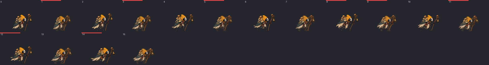

# 怪物动作重画清单（按优先级）

> 由 `tools/build_creature_redraw_list.py` 生成，只是报告，不影响游戏和 CI。重新生成：`python tools/build_creature_redraw_list.py --sheets artifacts/creature_redraw_list_20261111`。

46 种怪物按当前配置可路由的候选片段中，261 段至少有一项原画问题：大小不一致的帧 392 帧，跳帧 347 处，整段“沸腾”的待机／走路 60 段。

轮廓指标在固定画布上的原画空间测量，位于运行时 frame-fit 缩放之前，不代表最终画面仍有同样的跳动。大小和跳帧可能重复计数；需结合校正后画面人工复核，不能仅凭阈值要求补帧。已排除原画角色不使用的受击片段，以及被完整原画阶段替代的 charge／travel 等旧循环。候选集来自配置和生产路由规则，不是游玩播放统计。

三种标记的含义：

- **大小**：这一帧的身体比前后帧大或小 8% 以上（括号里是运行时目前用来遮掩的缩放值，重画时按这个比例改身体大小即可）。
- **跳帧**：相邻两帧之间一半以上的轮廓被替换，肢体或道具直接跳到新位置。写作“a→b”，需要在两帧之间补一张，或重画其中一张。
- **整段重画**：待机、走路这类平静动作，轮廓平均变化达到“整体平移 2px”的 3 倍以上，说明每帧都是重新画的。单修某一帧没用，要按同一套造型整段重出。

排序是估算，不是实测：出场次数（六章生成点数量，越早的章节越靠前，Boss 按 6 个小怪计）× 片段出现频率（待机和走路最高，攻击其次，受击最低）× 问题多少。帧号从 0 开始，是游戏当前读取的图层里的序号；`_left` 片段与 `_right` 内容对应，只列一边；死亡片段不列。

## 各怪物汇总

| 顺序 | 怪物 | 首次出现 | 生成点 | 问题片段 | 大小 | 跳帧 | 整段重画 |
|---|---|---|---|---|---|---|---|
| 1 | `rust_crown_guardian`（Boss） | 第 1 章 | — | 5 | 12 | 5 | 2 |
| 2 | `saltwhite_contract_judge`（Boss） | 第 3 章 | — | 10 | 14 | 24 | 1 |
| 3 | `sunken_hammer_smith`（Boss） | 第 2 章 | — | 9 | 21 | 15 | 0 |
| 4 | `spore_bellmaker` | 第 1 章 | 3 | 6 | 21 | 5 | 2 |
| 5 | `index_scribe` | 第 3 章 | 3 | 8 | 21 | 27 | 0 |
| 6 | `bronze_moth` | 第 1 章 | 2 | 7 | 8 | 35 | 2 |
| 7 | `root_cage_hunter` | 第 4 章 | 3 | 9 | 9 | 28 | 2 |
| 8 | `moss_larva` | 第 1 章 | 4 | 7 | 11 | 0 | 2 |
| 9 | `obsidian_spearman` | 第 5 章 | 3 | 9 | 18 | 23 | 1 |
| 10 | `wax_bee` | 第 4 章 | 3 | 8 | 20 | 10 | 2 |
| 11 | `silent_crown_core`（Boss） | 第 6 章 | — | 5 | 4 | 6 | 1 |
| 12 | `silent_pilgrim_commander`（Boss） | 第 5 章 | — | 10 | 22 | 0 | 0 |
| 13 | `corridor_heavy` | 第 1 章 | 2 | 6 | 9 | 21 | 1 |
| 14 | `broken_string_gardener`（Boss） | 第 4 章 | — | 6 | 14 | 2 | 0 |
| 15 | `drain_leech` | 第 2 章 | 2 | 5 | 7 | 10 | 2 |
| 16 | `wax_lancer` | 第 3 章 | 2 | 7 | 14 | 12 | 1 |
| 17 | `vine_crawler` | 第 4 章 | 3 | 6 | 9 | 0 | 2 |
| 18 | `rust_diver` | 第 2 章 | 3 | 5 | 3 | 0 | 2 |
| 19 | `page_duelist` | 第 3 章 | 3 | 4 | 2 | 8 | 1 |
| 20 | `bell_mote` | 第 2 章 | 2 | 4 | 0 | 8 | 2 |
| 21 | `summoned_page` | 第 3 章 | 1 | 8 | 24 | 10 | 2 |
| 22 | `echo_moss_larva` | 第 6 章 | 3 | 7 | 11 | 0 | 2 |
| 23 | `erasure_bailiff` | 第 3 章 | 2 | 5 | 6 | 3 | 2 |
| 24 | `bellroot_acolyte` | 第 1 章 | 1 | 7 | 5 | 17 | 2 |
| 25 | `pipe_thrower` | 第 2 章 | 3 | 4 | 2 | 1 | 1 |
| 26 | `waterwheel_knight` | 第 2 章 | 3 | 3 | 2 | 0 | 1 |
| 27 | `gear_sentinel` | 第 1 章 | 2 | 2 | 0 | 0 | 2 |
| 28 | `phase_censor` | 第 5 章 | 3 | 4 | 5 | 1 | 1 |
| 29 | `ash_banner_imp` | 第 5 章 | 1 | 7 | 7 | 38 | 0 |
| 30 | `salt_bookmite` | 第 3 章 | 3 | 1 | 0 | 0 | 1 |
| 31 | `thorn_bloom_mote` | 第 4 章 | 1 | 7 | 12 | 7 | 2 |
| 32 | `pollen_lutist` | 第 4 章 | 2 | 5 | 6 | 0 | 1 |
| 33 | `rain_censer_mote` | 第 2 章 | 1 | 6 | 6 | 4 | 2 |
| 34 | `echo_contract_scribe` | 第 6 章 | 2 | 5 | 6 | 3 | 1 |
| 35 | `isotope_lumen` | 第 6 章 | 1 | 8 | 14 | 7 | 2 |
| 36 | `pilgrim_chariot` | 第 5 章 | 2 | 2 | 0 | 0 | 2 |
| 37 | `valve_crawler` | 第 2 章 | 1 | 5 | 4 | 1 | 2 |
| 38 | `echo_thorn_sentinel` | 第 6 章 | 2 | 4 | 3 | 0 | 2 |
| 39 | `delayed_shadow` | 第 6 章 | 1 | 7 | 8 | 11 | 2 |
| 40 | `silent_bugbler` | 第 5 章 | 2 | 3 | 3 | 0 | 1 |
| 41 | `kneeling_crossbowman` | 第 5 章 | 2 | 4 | 3 | 0 | 1 |
| 42 | `obsidian_bellwheel` | 第 5 章 | 1 | 3 | 4 | 0 | 1 |
| 43 | `falling_clapper` | 第 6 章 | 1 | 5 | 4 | 4 | 1 |
| 44 | `echo_waterwheel_knight` | 第 6 章 | 3 | 4 | 6 | 0 | 0 |
| 45 | `echo_pilgrim_commander_minor` | 第 6 章 | 1 | 7 | 10 | 1 | 0 |
| 46 | `thorn_sentinel` | 第 4 章 | 2 | 2 | 2 | 0 | 0 |

## 最该先看的 24 段

每格左上角是帧号；格子顶部红条表示大小不一致，黄条表示它与上一帧之间跳帧。

**`rust_crown_guardian` / `walk`**

**`saltwhite_contract_judge` / `walk`**

**`rust_crown_guardian` / `idle`**

**`spore_bellmaker` / `walk`**

**`silent_crown_core` / `walk`**

**`root_cage_hunter` / `walk`**

**`moss_larva` / `walk`**

**`sunken_hammer_smith` / `phase`**

**`index_scribe` / `windup`**

**`saltwhite_contract_judge` / `heavy`**

**`spore_bellmaker` / `bell_fungus_windup`**

**`wax_lancer` / `walk`**

**`bronze_moth` / `walk`**

**`page_duelist` / `walk`**

**`bronze_moth` / `moth_dust_windup`**

**`sunken_hammer_smith` / `heavy`**

**`index_scribe` / `walk`**

**`pipe_thrower` / `walk`**

**`rust_diver` / `walk`**

**`waterwheel_knight` / `walk`**

**`wax_bee` / `recover`**

**`rust_crown_guardian` / `heavy`**

**`corridor_heavy` / `heavy_elite_quake_windup`**

**`salt_bookmite` / `walk`**

## 逐怪物、逐片段

### `rust_crown_guardian`

| 片段 | 帧数 | 大小不一致的帧 | 跳帧 | 整段重画 |
|---|---|---|---|---|
| `walk` | 32 | 4（×1.081）；6（×0.918） | — | 是 |
| `idle` | 16 | 12（×1.082） | — | 是 |
| `heavy` | 24 | 10（×0.879）；12（×1.099） | 3→4、15→16 | — |
| `phase_windup` | 24 | 20（×1.15）；23（×1.113） | 21→22 | — |
| `phase` | 24 | 2（×0.883）；14（×1.094）；16（×0.912）；20（×0.903）；22（×1.098） | 3→4、6→7 | — |

### `saltwhite_contract_judge`

| 片段 | 帧数 | 大小不一致的帧 | 跳帧 | 整段重画 |
|---|---|---|---|---|
| `walk` | 32 | — | — | 是 |
| `heavy` | 24 | 12（×1.099）；14（×0.891） | 6→7、8→9、9→10、11→12、12→13、15→16 | — |
| `attack` | 24 | 18（×1.106）；20（×0.889）；23（×1.081） | 5→6、6→7 | — |
| `phase` | 24 | — | 3→4、4→5、5→6、6→7、7→8、8→9、9→10、11→12、12→13、18→19 | — |
| `idle` | 16 | 8（×1.086）；10（×0.895）；12（×1.087） | — | — |
| `cast` | 24 | 22（×0.914） | 5→6、12→13、14→15 | — |
| `cast_recover` | 24 | 9（×0.915）；20（×0.917） | 2→3 | — |
| `heavy_recover` | 24 | 6（×1.092）；11（×1.087） | — | — |
| `windup` | 24 | — | 21→22、22→23 | — |
| `phase_windup` | 24 | 0（×1.146） | — | — |

### `sunken_hammer_smith`

| 片段 | 帧数 | 大小不一致的帧 | 跳帧 | 整段重画 |
|---|---|---|---|---|
| `phase` | 24 | 2（×1.148）；5（×0.915）；16（×0.901）；18（×1.119）；20（×0.912） | 2→3、3→4、9→10、11→12、15→16、17→18、18→19、20→21、21→22 | — |
| `heavy` | 24 | 4（×0.906）；12（×1.112）；14（×0.87）；16（×1.085） | 15→16 | — |
| `windup` | 24 | 6（×1.09）；9（×0.9）；14（×0.914）；15（×0.92） | — | — |
| `phase_windup` | 24 | 8（×0.914）；20（×0.92）；23（×1.128） | — | — |
| `attack` | 24 | 18（×1.102） | 9→10、18→19 | — |
| `cast` | 24 | — | 11→12、12→13、21→22 | — |
| `cast_recover` | 24 | 3（×0.916）；18（×1.084） | — | — |
| `recover` | 24 | 18（×1.094） | — | — |
| `heavy_windup` | 24 | 0（×1.085） | — | — |

### `spore_bellmaker`

| 片段 | 帧数 | 大小不一致的帧 | 跳帧 | 整段重画 |
|---|---|---|---|---|
| `walk` | 16 | 1（×1.097）；3（×1.084）；5（×1.083）；8（×0.911）；9（×1.087）；11（×1.098）；12（×0.92）；14（×0.917） | — | 是 |
| `bell_fungus_windup` | 24 | 2（×0.896）；11（×1.099）；17（×1.095）；19（×1.15）；20（×1.12）；22（×0.881） | 4→5、5→6、6→7、7→8 | — |
| `idle` | 8 | — | — | 是 |
| `attack` | 24 | 1（×1.087）；4（×0.875）；7（×1.084）；14（×0.917） | — | — |
| `windup` | 24 | 2（×0.897）；22（×0.907） | 21→22 | — |
| `bell_fungus_recover` | 24 | 16（×0.907） | — | — |

### `index_scribe`

| 片段 | 帧数 | 大小不一致的帧 | 跳帧 | 整段重画 |
|---|---|---|---|---|
| `windup` | 24 | 22（×0.889） | 0→1、1→2、7→8、9→10、10→11、11→12、12→13、13→14、14→15、15→16、16→17、17→18、18→19、19→20、20→21 | — |
| `walk` | 16 | 1（×1.086）；2（×0.917）；3（×1.082）；13（×1.081）；15（×1.082） | 4→5、5→6、6→7、14→15 | — |
| `index_seal_recover` | 24 | 2（×0.91）；10（×0.918）；14（×0.913）；20（×0.918）；23（×1.113） | — | — |
| `attack` | 24 | 5（×1.094）；8（×0.902） | 17→18、18→19、19→20 | — |
| `recover` | 24 | 17（×1.082）；19（×1.091）；22（×0.918）；23（×1.091） | 1→2 | — |
| `idle` | 8 | — | 0→1、6→7、7→0 | — |
| `index_seal` | 24 | 4（×0.918）；10（×0.912）；14（×0.912） | — | — |
| `index_seal_windup` | 24 | 22（×0.911） | 21→22 | — |

### `bronze_moth`

| 片段 | 帧数 | 大小不一致的帧 | 跳帧 | 整段重画 |
|---|---|---|---|---|
| `walk` | 16 | 0（×0.88）；4（×0.904） | 7→8、15→0 | 是 |
| `moth_dust_windup` | 24 | — | 0→1、1→2、2→3、3→4、4→5、5→6、6→7、7→8、9→10、10→11、11→12、15→16、16→17、17→18 | — |
| `moth_dust_recover` | 24 | — | 0→1、1→2、2→3、3→4、4→5、5→6、6→7、7→8、8→9、9→10 | — |
| `moth_dust` | 24 | 14（×0.919） | 3→4、9→10、16→17、17→18、18→19、19→20、21→22、22→23 | — |
| `idle` | 8 | — | — | 是 |
| `attack` | 24 | 5（×1.08）；8（×0.908）；19（×1.08） | 12→13 | — |
| `windup` | 24 | 6（×1.082）；7（×1.08） | — | — |

### `root_cage_hunter`

| 片段 | 帧数 | 大小不一致的帧 | 跳帧 | 整段重画 |
|---|---|---|---|---|
| `walk` | 16 | 0（×0.899）；3（×1.083）；15（×1.082） | 1→2、2→3、4→5、5→6、7→8、11→12、13→14、14→15 | 是 |
| `idle` | 8 | — | 6→7、7→0 | 是 |
| `attack` | 24 | — | 15→16、16→17、17→18、18→19、19→20、20→21 | — |
| `cage_pounce` | 24 | 22（×0.892） | 15→16、16→17、17→18、18→19 | — |
| `recover` | 24 | 1（×1.091）；23（×1.089） | 5→6、6→7、7→8 | — |
| `windup` | 24 | 8（×0.911） | 5→6、9→10、21→22 | — |
| `cage_elite_snare_recover` | 24 | 23（×1.08） | 22→23 | — |
| `cage_elite_snare_windup` | 24 | — | 21→22 | — |
| `cage_elite_snare` | 24 | 18（×1.084） | — | — |

### `moss_larva`

| 片段 | 帧数 | 大小不一致的帧 | 跳帧 | 整段重画 |
|---|---|---|---|---|
| `walk` | 16 | — | — | 是 |
| `idle` | 8 | — | — | 是 |
| `larva_snap_recover` | 24 | 12（×1.084）；17（×1.098）；18（×1.108）；20（×0.911） | — | — |
| `larva_snap` | 24 | 4（×0.902）；10（×0.909）；14（×0.915） | — | — |
| `larva_snap_windup` | 24 | 0（×1.097）；22（×0.906） | — | — |
| `attack` | 24 | 18（×1.104） | — | — |
| `windup` | 24 | 22（×0.9） | — | — |

### `obsidian_spearman`

| 片段 | 帧数 | 大小不一致的帧 | 跳帧 | 整段重画 |
|---|---|---|---|---|
| `obsidian_elite_impale_recover` | 24 | 20（×0.9）；23（×1.109） | 0→1、1→2、2→3、3→4、4→5、5→6、6→7、7→8、21→22 | — |
| `obsidian_elite_impale` | 24 | 1（×1.1）；2（×1.103）；6（×1.101）；8（×0.87）；16（×0.874） | 7→8、9→10、15→16、21→22、22→23 | — |
| `walk` | 16 | 12（×0.919） | — | 是 |
| `obsidian_raise` | 24 | 2（×0.898）；8（×0.91）；14（×0.892）；22（×0.9） | 21→22 | — |
| `obsidian_elite_impale_windup` | 24 | — | 2→3、7→8、9→10、10→11、11→12 | — |
| `windup` | 24 | 14（×0.895）；17（×1.082） | 21→22、22→23 | — |
| `obsidian_raise_recover` | 24 | 4（×0.901）；20（×0.883）；23（×1.091） | — | — |
| `recover` | 24 | 23（×1.092） | — | — |
| `attack` | 24 | — | 15→16 | — |

### `wax_bee`

| 片段 | 帧数 | 大小不一致的帧 | 跳帧 | 整段重画 |
|---|---|---|---|---|
| `recover` | 24 | 1（×1.081）；3（×1.083）；5（×1.099）；7（×1.098）；10（×0.886）；14（×0.918）；17（×1.11）；20（×0.896） | 0→1、2→3、4→5、5→6、6→7 | — |
| `walk` | 16 | — | — | 是 |
| `idle` | 8 | — | 7→0 | 是 |
| `bee_stingers_windup` | 24 | 4（×1.083）；6（×1.082） | 0→1、1→2、2→3、3→4 | — |
| `attack` | 24 | 4（×0.912）；5（×1.106）；8（×0.871）；20（×0.886） | — | — |
| `bee_stingers_recover` | 24 | 6（×1.088）；12（×1.087）；18（×1.118） | — | — |
| `bee_stingers` | 24 | 0（×1.085）；3（×0.914） | — | — |
| `windup` | 24 | 22（×0.883） | — | — |

### `silent_crown_core`

| 片段 | 帧数 | 大小不一致的帧 | 跳帧 | 整段重画 |
|---|---|---|---|---|
| `walk` | 32 | — | — | 是 |
| `heavy` | 24 | 8（×1.117）；12（×1.081） | 11→12 | — |
| `phase` | 24 | — | 9→10、10→11、11→12、12→13、15→16 | — |
| `phase_windup` | 24 | 6（×1.085） | — | — |
| `windup` | 24 | 22（×0.917） | — | — |

### `silent_pilgrim_commander`

| 片段 | 帧数 | 大小不一致的帧 | 跳帧 | 整段重画 |
|---|---|---|---|---|
| `heavy_windup` | 24 | 10（×0.883）；20（×0.87）；22（×1.131）；23（×1.086） | — | — |
| `heavy` | 24 | 2（×1.113）；4（×0.895）；14（×0.902）；22（×0.897） | — | — |
| `cast_recover` | 24 | 6（×1.086）；12（×1.102）；18（×1.108） | — | — |
| `cast` | 24 | 4（×0.903）；6（×1.103）；12（×1.085） | — | — |
| `cast_windup` | 24 | 18（×1.099）；22（×1.087） | — | — |
| `phase` | 24 | 0（×1.1）；12（×1.107） | — | — |
| `phase_recover` | 24 | 18（×1.097） | — | — |
| `windup` | 24 | 16（×0.91） | — | — |
| `attack` | 24 | 10（×0.916） | — | — |
| `recover` | 24 | 18（×1.083） | — | — |

### `corridor_heavy`

| 片段 | 帧数 | 大小不一致的帧 | 跳帧 | 整段重画 |
|---|---|---|---|---|
| `heavy_elite_quake_windup` | 24 | 2（×0.906） | 6→7、7→8、8→9、9→10、10→11、11→12、15→16、16→17、17→18、18→19、21→22、22→23 | — |
| `walk` | 16 | — | — | 是 |
| `heavy_elite_quake` | 24 | 8（×0.87）；10（×1.083）；16（×0.892） | 0→1、1→2、15→16、21→22、22→23 | — |
| `heavy_stamp_windup` | 24 | 2（×0.909）；14（×0.916）；15（×1.088） | 12→13、13→14 | — |
| `heavy_stamp` | 24 | 1（×1.095）；2（×1.094） | 5→6 | — |
| `windup` | 24 | — | 0→1 | — |

### `broken_string_gardener`

| 片段 | 帧数 | 大小不一致的帧 | 跳帧 | 整段重画 |
|---|---|---|---|---|
| `heavy_windup` | 24 | 2（×1.084）；4（×0.898）；9（×0.906）；12（×1.135） | — | — |
| `windup` | 24 | 6（×1.083）；8（×0.907）；9（×0.891） | — | — |
| `heavy` | 24 | 7（×1.082）；8（×1.101）；16（×1.083） | — | — |
| `phase_windup` | 24 | 8（×1.086）；12（×1.093） | 9→10 | — |
| `recover` | 24 | 0（×1.086）；12（×1.082） | — | — |
| `phase` | 24 | — | 3→4 | — |

### `drain_leech`

| 片段 | 帧数 | 大小不一致的帧 | 跳帧 | 整段重画 |
|---|---|---|---|---|
| `leech_leap` | 24 | 7（×1.13）；8（×1.15）；12（×1.106）；14（×0.87）；16（×1.1）；20（×1.126）；22（×0.919） | 9→10、15→16、21→22 | — |
| `walk` | 16 | — | — | 是 |
| `leech_leap_recover` | 24 | — | 2→3、3→4、4→5、5→6、6→7、7→8 | — |
| `idle` | 8 | — | — | 是 |
| `windup` | 24 | — | 21→22 | — |

### `wax_lancer`

| 片段 | 帧数 | 大小不一致的帧 | 跳帧 | 整段重画 |
|---|---|---|---|---|
| `walk` | 16 | 1（×1.086）；2（×0.917）；3（×1.082）；5（×1.082）；8（×0.919） | 0→1、7→8、15→0 | 是 |
| `wax_high_windup` | 24 | 12（×1.097）；13（×1.085）；16（×0.901）；20（×0.914） | — | — |
| `windup` | 24 | 22（×0.887） | 0→1、3→4、5→6 | — |
| `attack` | 24 | 18（×1.092） | 21→22、22→23 | — |
| `wax_high_recover` | 24 | 12（×1.12）；18（×1.125） | — | — |
| `recover` | 24 | — | 1→2、3→4、12→13 | — |
| `wax_high` | 24 | 2（×0.906） | 9→10 | — |

### `vine_crawler`

| 片段 | 帧数 | 大小不一致的帧 | 跳帧 | 整段重画 |
|---|---|---|---|---|
| `walk` | 16 | — | — | 是 |
| `idle` | 8 | — | — | 是 |
| `vine_roots` | 24 | 7（×1.082）；10（×0.917）；18（×1.081）；20（×0.87） | — | — |
| `vine_roots_windup` | 24 | 20（×1.091）；22（×0.908） | — | — |
| `attack` | 24 | 5（×1.081）；8（×0.92） | — | — |
| `vine_roots_recover` | 24 | 6（×1.082） | — | — |

### `rust_diver`

| 片段 | 帧数 | 大小不一致的帧 | 跳帧 | 整段重画 |
|---|---|---|---|---|
| `walk` | 16 | — | — | 是 |
| `idle` | 8 | — | — | 是 |
| `windup` | 24 | 16（×0.889） | — | — |
| `diver_splash_windup` | 24 | 8（×0.903） | — | — |
| `diver_splash` | 24 | 20（×0.916） | — | — |

### `page_duelist`

| 片段 | 帧数 | 大小不一致的帧 | 跳帧 | 整段重画 |
|---|---|---|---|---|
| `walk` | 16 | — | 12→13、14→15 | 是 |
| `attack` | 24 | — | 3→4、17→18、18→19、21→22 | — |
| `page_elite_flurry` | 24 | 20（×0.894）；22（×1.085） | — | — |
| `windup` | 24 | — | 5→6、6→7 | — |

### `bell_mote`

| 片段 | 帧数 | 大小不一致的帧 | 跳帧 | 整段重画 |
|---|---|---|---|---|
| `walk` | 16 | — | 2→3、3→4 | 是 |
| `idle` | 8 | — | 7→0 | 是 |
| `mote_seek_windup` | 24 | — | 8→9、9→10、10→11、11→12 | — |
| `recover` | 24 | — | 6→7 | — |

### `summoned_page`

| 片段 | 帧数 | 大小不一致的帧 | 跳帧 | 整段重画 |
|---|---|---|---|---|
| `walk` | 16 | 8（×0.9）；14（×0.911） | — | 是 |
| `page_orbit_windup` | 24 | — | 4→5、5→6、6→7、7→8、8→9、9→10、10→11、11→12 | — |
| `attack` | 24 | 4（×0.919）；8（×0.919）；11（×1.103）；14（×0.91）；16（×0.919）；19（×1.083）；20（×0.916）；23（×1.137） | — | — |
| `recover` | 24 | 3（×0.912）；4（×0.905）；6（×1.096）；8（×0.916）；17（×1.111）；18（×1.124）；23（×1.139） | — | — |
| `windup` | 24 | 0（×1.093）；12（×1.093）；14（×0.903）；15（×0.913） | 2→3、19→20 | — |
| `idle` | 8 | — | — | 是 |
| `page_orbit_recover` | 24 | 12（×1.104）；20（×0.906） | — | — |
| `page_orbit` | 24 | 18（×1.124） | — | — |

### `echo_moss_larva`

| 片段 | 帧数 | 大小不一致的帧 | 跳帧 | 整段重画 |
|---|---|---|---|---|
| `walk` | 16 | — | — | 是 |
| `idle` | 8 | — | — | 是 |
| `echo_larva_mark` | 24 | 4（×0.915）；10（×0.87）；20（×0.896） | — | — |
| `windup` | 24 | 2（×0.885）；5（×1.081）；22（×0.897） | — | — |
| `echo_larva_mark_windup` | 24 | 8（×0.912）；23（×1.112） | — | — |
| `echo_larva_mark_recover` | 24 | 2（×0.912）；16（×0.898） | — | — |
| `attack` | 24 | 12（×1.084） | — | — |

### `erasure_bailiff`

| 片段 | 帧数 | 大小不一致的帧 | 跳帧 | 整段重画 |
|---|---|---|---|---|
| `walk` | 16 | — | — | 是 |
| `idle` | 8 | — | — | 是 |
| `attack` | 24 | 4（×0.899）；10（×0.904）；18（×1.087）；20（×0.87） | — | — |
| `bailiff_erase` | 24 | 2（×1.083） | 5→6、6→7、9→10 | — |
| `bailiff_elite_sweep_recover` | 24 | 8（×0.896） | — | — |

### `bellroot_acolyte`

| 片段 | 帧数 | 大小不一致的帧 | 跳帧 | 整段重画 |
|---|---|---|---|---|
| `walk` | 16 | 8（×0.918） | 14→15 | 是 |
| `idle` | 8 | — | 6→7、7→0 | 是 |
| `root_bell_wave_windup` | 24 | 20（×1.081） | 0→1、1→2、2→3、20→21、21→22、22→23 | — |
| `root_bell_wave` | 24 | — | 0→1、1→2、2→3、3→4、5→6、6→7 | — |
| `root_bell_wave_recover` | 24 | 20（×0.909）；23（×1.088） | — | — |
| `windup` | 24 | 11（×1.093） | 0→1 | — |
| `attack` | 24 | — | 9→10 | — |

### `pipe_thrower`

| 片段 | 帧数 | 大小不一致的帧 | 跳帧 | 整段重画 |
|---|---|---|---|---|
| `walk` | 16 | — | — | 是 |
| `recover` | 24 | 14（×0.895） | — | — |
| `pipe_mortar_recover` | 24 | 20（×0.9） | — | — |
| `attack` | 24 | — | 13→14 | — |

### `waterwheel_knight`

| 片段 | 帧数 | 大小不一致的帧 | 跳帧 | 整段重画 |
|---|---|---|---|---|
| `walk` | 16 | — | — | 是 |
| `recover` | 24 | 18（×1.086） | — | — |
| `windup` | 24 | 22（×0.917） | — | — |

### `gear_sentinel`

| 片段 | 帧数 | 大小不一致的帧 | 跳帧 | 整段重画 |
|---|---|---|---|---|
| `walk` | 16 | — | — | 是 |
| `idle` | 8 | — | — | 是 |

### `phase_censor`

| 片段 | 帧数 | 大小不一致的帧 | 跳帧 | 整段重画 |
|---|---|---|---|---|
| `walk` | 16 | 3（×1.08） | — | 是 |
| `windup` | 24 | 2（×0.912）；16（×0.918） | 0→1 | — |
| `censor_blink` | 24 | 20（×0.904） | — | — |
| `attack` | 24 | 2（×0.914） | — | — |

### `ash_banner_imp`

| 片段 | 帧数 | 大小不一致的帧 | 跳帧 | 整段重画 |
|---|---|---|---|---|
| `imp_retreat_windup` | 24 | 14（×1.088） | 0→1、1→2、4→5、5→6、6→7、7→8、8→9、9→10、10→11、11→12、15→16、17→18、18→19、19→20、20→21、21→22 | — |
| `imp_retreat` | 24 | 18（×1.08）；19（×0.905）；20（×0.898） | 3→4、4→5、5→6、6→7、8→9、10→11、11→12、21→22 | — |
| `windup` | 24 | 2（×1.113）；8（×1.081） | 3→4、5→6、8→9、9→10、10→11、11→12、15→16 | — |
| `attack` | 24 | — | 3→4、21→22、22→23 | — |
| `recover` | 24 | 2（×1.084） | 3→4、6→7 | — |
| `idle` | 8 | — | 2→3 | — |
| `walk` | 16 | — | 3→4 | — |

### `salt_bookmite`

| 片段 | 帧数 | 大小不一致的帧 | 跳帧 | 整段重画 |
|---|---|---|---|---|
| `walk` | 16 | — | — | 是 |

### `thorn_bloom_mote`

| 片段 | 帧数 | 大小不一致的帧 | 跳帧 | 整段重画 |
|---|---|---|---|---|
| `walk` | 16 | — | — | 是 |
| `bloom_seeds_windup` | 24 | 6（×1.082）；20（×0.904） | 9→10、10→11、11→12、21→22、22→23 | — |
| `idle` | 8 | — | — | 是 |
| `attack` | 24 | 4（×0.907）；6（×1.088）；12（×1.099）；14（×0.903） | — | — |
| `windup` | 24 | 10（×0.909）；18（×1.08）；20（×0.871） | — | — |
| `bloom_seeds_recover` | 24 | 0（×1.092）；18（×1.107）；20（×0.914） | — | — |
| `bloom_seeds` | 24 | — | 1→2、2→3 | — |

### `pollen_lutist`

| 片段 | 帧数 | 大小不一致的帧 | 跳帧 | 整段重画 |
|---|---|---|---|---|
| `walk` | 16 | — | — | 是 |
| `pollen_spots` | 24 | 16（×0.9）；20（×0.895） | — | — |
| `windup` | 24 | 14（×0.909）；22（×0.895） | — | — |
| `attack` | 24 | 8（×0.889） | — | — |
| `recover` | 24 | 17（×1.087） | — | — |

### `rain_censer_mote`

| 片段 | 帧数 | 大小不一致的帧 | 跳帧 | 整段重画 |
|---|---|---|---|---|
| `walk` | 16 | — | — | 是 |
| `idle` | 8 | — | — | 是 |
| `censer_cloud_windup` | 24 | 0（×1.087） | 8→9、9→10、10→11、11→12 | — |
| `censer_cloud_recover` | 24 | 12（×1.083）；23（×1.112） | — | — |
| `recover` | 24 | 18（×1.087）；23（×1.094） | — | — |
| `windup` | 24 | 13（×1.088） | — | — |

### `echo_contract_scribe`

| 片段 | 帧数 | 大小不一致的帧 | 跳帧 | 整段重画 |
|---|---|---|---|---|
| `walk` | 16 | — | — | 是 |
| `echo_scribe_seals_windup` | 24 | 14（×0.913）；20（×1.101） | 12→13、21→22 | — |
| `attack` | 24 | 12（×1.091）；22（×1.098） | 20→21 | — |
| `echo_scribe_seals` | 24 | 10（×0.885） | — | — |
| `windup` | 24 | 22（×0.89） | — | — |

### `isotope_lumen`

| 片段 | 帧数 | 大小不一致的帧 | 跳帧 | 整段重画 |
|---|---|---|---|---|
| `walk` | 16 | 8（×0.887）；9（×1.084） | — | 是 |
| `idle` | 8 | — | 0→1、1→2、7→0 | 是 |
| `windup` | 24 | 2（×0.894）；14（×0.917）；19（×1.089）；23（×1.119） | 5→6、18→19 | — |
| `lumen_focus_windup` | 24 | 20（×0.876） | 21→22、22→23 | — |
| `attack` | 24 | 1（×1.089）；4（×0.891）；8（×0.914） | — | — |
| `recover` | 24 | 14（×0.901）；17（×1.082） | — | — |
| `lumen_focus` | 24 | 22（×0.897） | — | — |
| `lumen_focus_recover` | 24 | 20（×0.905） | — | — |

### `pilgrim_chariot`

| 片段 | 帧数 | 大小不一致的帧 | 跳帧 | 整段重画 |
|---|---|---|---|---|
| `walk` | 16 | — | — | 是 |
| `idle` | 8 | — | — | 是 |

### `valve_crawler`

| 片段 | 帧数 | 大小不一致的帧 | 跳帧 | 整段重画 |
|---|---|---|---|---|
| `walk` | 16 | — | — | 是 |
| `idle` | 8 | — | — | 是 |
| `attack` | 24 | 16（×0.906）；20（×0.876）；23（×1.08） | — | — |
| `windup` | 24 | 12（×1.098） | — | — |
| `valve_vent_windup` | 24 | — | 7→8 | — |

### `echo_thorn_sentinel`

| 片段 | 帧数 | 大小不一致的帧 | 跳帧 | 整段重画 |
|---|---|---|---|---|
| `walk` | 16 | — | — | 是 |
| `idle` | 8 | — | — | 是 |
| `windup` | 24 | 16（×0.911）；20（×0.918） | — | — |
| `echo_thorn_double` | 24 | 10（×0.915） | — | — |

### `delayed_shadow`

| 片段 | 帧数 | 大小不一致的帧 | 跳帧 | 整段重画 |
|---|---|---|---|---|
| `walk` | 16 | 8（×0.919） | 0→1、11→12、15→0 | 是 |
| `idle` | 8 | — | 0→1、1→2 | 是 |
| `recover` | 24 | — | 9→10、10→11、11→12、17→18 | — |
| `attack` | 24 | 5（×1.11）；6（×1.088）；8（×0.915） | — | — |
| `shadow_echo_windup` | 24 | 8（×0.899）；22（×0.912） | 21→22 | — |
| `shadow_echo_recover` | 24 | 20（×0.917） | 22→23 | — |
| `shadow_echo` | 24 | 14（×0.904） | — | — |

### `silent_bugbler`

| 片段 | 帧数 | 大小不一致的帧 | 跳帧 | 整段重画 |
|---|---|---|---|---|
| `walk` | 16 | — | — | 是 |
| `bugle_pulse_recover` | 24 | 20（×0.885）；23（×1.081） | — | — |
| `attack` | 24 | 20（×0.92） | — | — |

### `kneeling_crossbowman`

| 片段 | 帧数 | 大小不一致的帧 | 跳帧 | 整段重画 |
|---|---|---|---|---|
| `walk` | 16 | — | — | 是 |
| `crossbow_low_windup` | 24 | 18（×1.086） | — | — |
| `recover` | 24 | 18（×1.08） | — | — |
| `windup` | 24 | 19（×1.08） | — | — |

### `obsidian_bellwheel`

| 片段 | 帧数 | 大小不一致的帧 | 跳帧 | 整段重画 |
|---|---|---|---|---|
| `walk` | 16 | — | — | 是 |
| `bellwheel_waves` | 24 | 10（×0.87）；12（×1.117）；14（×0.892） | — | — |
| `bellwheel_waves_recover` | 24 | 2（×0.914） | — | — |

### `falling_clapper`

| 片段 | 帧数 | 大小不一致的帧 | 跳帧 | 整段重画 |
|---|---|---|---|---|
| `walk` | 16 | — | — | 是 |
| `clapper_wave_windup` | 24 | — | 5→6、6→7、8→9、9→10 | — |
| `attack` | 24 | 10（×0.886）；15（×0.914） | — | — |
| `clapper_wave_recover` | 24 | 20（×0.914） | — | — |
| `recover` | 24 | 10（×0.916） | — | — |

### `echo_waterwheel_knight`

| 片段 | 帧数 | 大小不一致的帧 | 跳帧 | 整段重画 |
|---|---|---|---|---|
| `attack` | 24 | 6（×1.091）；18（×1.119） | — | — |
| `echo_wheel_wave` | 24 | 4（×0.919）；20（×0.905） | — | — |
| `recover` | 24 | 18（×1.089） | — | — |
| `echo_wheel_elite_recover` | 24 | 20（×0.918） | — | — |

### `echo_pilgrim_commander_minor`

| 片段 | 帧数 | 大小不一致的帧 | 跳帧 | 整段重画 |
|---|---|---|---|---|
| `minor_elite_rally_recover` | 24 | 8（×0.87）；16（×0.907） | — | — |
| `minor_banner_recover` | 24 | 14（×0.906）；22（×0.905） | — | — |
| `minor_banner_windup` | 24 | 22（×0.894） | 21→22 | — |
| `windup` | 24 | 22（×0.917）；23（×1.082） | — | — |
| `attack` | 24 | 18（×1.111） | — | — |
| `minor_elite_rally_windup` | 24 | 2（×0.91） | — | — |
| `minor_elite_rally` | 24 | 2（×1.085） | — | — |

### `thorn_sentinel`

| 片段 | 帧数 | 大小不一致的帧 | 跳帧 | 整段重画 |
|---|---|---|---|---|
| `thorn_ring_windup` | 24 | 2（×0.895） | — | — |
| `windup` | 24 | 10（×0.91） | — | — |
